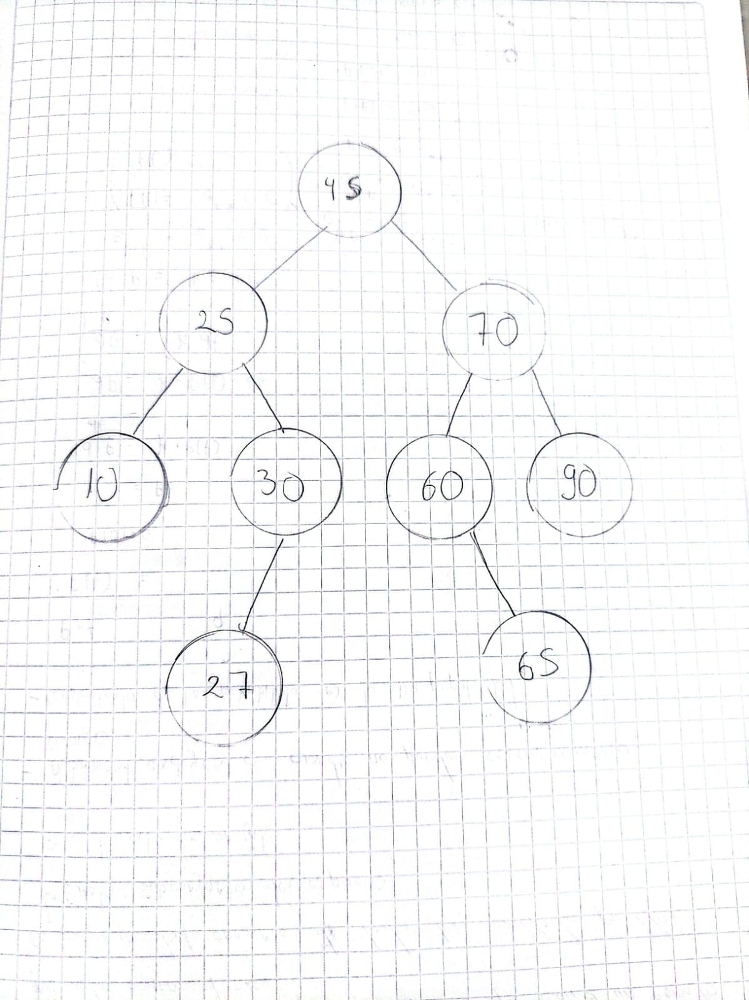

# Reto: recorridos recursivos de un árbol binario de búsqueda

**Universidad Técnica de Ambato - FISEI - Carrera de Software**
**Asignatura:** Estructura de Datos | **Paralelo:** SW-N3-A

## Descripción

Se insertan, uno por uno, las matrículas `45, 25, 70, 10, 30, 60, 90, 27, 65` en un árbol binario de búsqueda (ABB). Luego se implementan, **solo con recursión**, los recorridos preorden, inorden y posorden. Cada uno imprime una traza con sangría (2 espacios por nivel) que muestra la pila de llamadas.

Restricciones:
- Sin bucles ni ordenar listas para recorrer el árbol.
- Caso base: `nodo == null`.
- Una llamada recursiva por cada hijo.

## Estructura del proyecto

```
reto/
├── RetoRecorridos.java   # clase principal (insertar, recorridos, altura, main)
├── Estudiante.java       # ya existe en el proyecto
└── NodoEstudiante.java   # ya existe en el proyecto
capturas/
└── arbolResultado.png    # árbol dibujado a mano (resultado del reto)
```

## Árbol resultante

```
              45
           /      \
         25        70
        /  \      /  \
      10    30   60   90
           /       \
         27         65
```

## Predicción (resultado esperado)

| Recorrido | Orden | Resultado |
|-----------|-------|-----------|
| Preorden  | nodo, izquierda, derecha | `45 25 10 30 27 70 60 65 90` |
| Inorden   | izquierda, nodo, derecha | `10 25 27 30 45 60 65 70 90` |
| Posorden  | izquierda, derecha, nodo | `10 27 30 25 65 60 90 70 45` |

El inorden sale ordenado de menor a mayor: es una propiedad de todo ABB.

## Implementación de los TODO

### Preorden
```java
static void preorden(NodoEstudiante nodo, String sangria, StringBuilder salida) {
    if (nodo == null) {
        System.out.println(sangria + "null -> regresa");
        return;
    }
    int m = nodo.getDato().getMatricula();
    System.out.println(sangria + "entra " + m);
    System.out.println(sangria + "VISITA " + m);
    salida.append(m).append(' ');
    preorden(nodo.getIzquierdo(), sangria + "  ", salida);
    preorden(nodo.getDerecho(), sangria + "  ", salida);
}
```

### Inorden
```java
static void inorden(NodoEstudiante nodo, String sangria, StringBuilder salida) {
    if (nodo == null) {
        System.out.println(sangria + "null -> regresa");
        return;
    }
    int m = nodo.getDato().getMatricula();
    System.out.println(sangria + "entra " + m);
    inorden(nodo.getIzquierdo(), sangria + "  ", salida);
    System.out.println(sangria + "VISITA " + m);
    salida.append(m).append(' ');
    inorden(nodo.getDerecho(), sangria + "  ", salida);
}
```

### Posorden
```java
static void posorden(NodoEstudiante nodo, String sangria, StringBuilder salida) {
    if (nodo == null) {
        System.out.println(sangria + "null -> regresa");
        return;
    }
    int m = nodo.getDato().getMatricula();
    System.out.println(sangria + "entra " + m);
    posorden(nodo.getIzquierdo(), sangria + "  ", salida);
    posorden(nodo.getDerecho(), sangria + "  ", salida);
    System.out.println(sangria + "VISITA " + m);
    salida.append(m).append(' ');
}
```

### Altura (extra, en aristas)
```java
static int altura(NodoEstudiante nodo) {
    if (nodo == null) return -1;          // árbol vacío
    return 1 + Math.max(altura(nodo.getIzquierdo()), altura(nodo.getDerecho()));
}
```

Una hoja devuelve `1 + max(-1, -1) = 0`, como pide el enunciado.

## Cómo ejecutar

Desde la carpeta que contiene `reto/`:

```bash
javac reto/*.java
java reto.RetoRecorridos
```

O ejecuta `main` desde tu IDE (NetBeans, IntelliJ, Eclipse).

## Resultados

### Árbol dibujado



### Resultados esperados

| Caso | Preorden | Inorden | Posorden | Altura |
|------|----------|---------|----------|--------|
| Reto SW-N3-A | `45 25 10 30 27 70 60 65 90` | `10 25 27 30 45 60 65 70 90` | `10 27 30 25 65 60 90 70 45` | 3 |
| Árbol vacío | (vacío) | (vacío) | (vacío) | -1 |
| Un solo nodo (50) | `50` | `50` | `50` | 0 |
| Cadena (10, 20, 30, 40) | `10 20 30 40` | `10 20 30 40` | `40 30 20 10` | 3 |
| Repetido (20, 30, 30, 10) | `20 10 30` | `10 20 30` | `10 30 20` | 1 |

## Ejemplo de traza (inicio del preorden)

```
-- traza PREORDEN
entra 45
VISITA 45
  entra 25
  VISITA 25
    entra 10
    VISITA 10
      null -> regresa
      null -> regresa
    entra 30
    ...
```

## Integrantes

- ______________________________
- ______________________________
